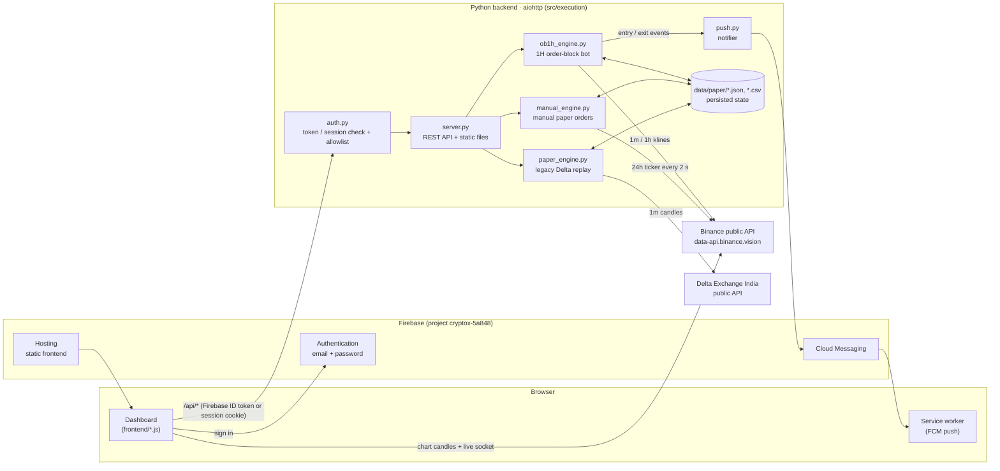

# CryptoX · Delta Desk

A BTC paper-trading terminal and strategy research lab. It streams public market data, runs trading strategies against it as **simulated (paper) trades**, lets you place manual paper orders, and pushes trade alerts to your browser. A separate research harness backtests strategy ideas with costs, out-of-sample splits and placebo tests before anything is allowed near the paper engine.

> **No real orders.** Nothing in this repository places exchange orders. `LIVE_TRADING=true` does not enable order placement. All P&L shown is simulated.

## Features

- **Live dashboard:** a BTCUSDT candlestick chart (Binance public feed) with a JavaScript port of LuxAlgo's Smart Money Concepts indicator, shown in IST.
- **1H order-block mitigation paper bot:** trades the first revisit of 1h order blocks. The stop sits beyond the block and starts trailing only once a closed candle is 1.5R in profit.
- **Manual paper trading:** several long and short positions at once, each with its own stop-loss, take-profit and percentage trail, with profit and loss shown in green and red.
- **Strategy catalog and trade history:** independent paper accounts, combined and filterable history.
- **Login and alerts:** Firebase email/password sign-in with an email allowlist, plus Firebase Cloud Messaging push on trade entry and exit.
- **Research harness:** frozen-protocol backtests of order blocks, support/resistance zones, Supertrend, EMA/VWAP, volume profile and order flow. Most found **no edge after costs**, and the results are kept as documented negatives.

## Architecture at a glance



Full component, data-flow, sequence and deployment diagrams are in **[docs/ARCHITECTURE.md](docs/ARCHITECTURE.md)**.

## Data flow in one paragraph

Public market data comes in from Binance (1m and 1h klines, 24h ticker), plus Delta for the legacy replay. Each engine runs as its own asyncio task. It turns **closed** candles or fresh quotes into simulated fills: next-1m-open entries, stop and target checks, and trailing updates. It applies fees and slippage, then writes its state atomically to `data/paper/`. The API merges every engine's snapshot into `/api/strategies`, `/api/positions` and `/api/trades`, which the dashboard polls. Entry and exit events go through the notifier to FCM and reach the browser's service worker. Research scripts read archived Binance 1m data from `data/` (not committed) and write reports to `research/` and `data/reports/`.

## Quick start

Requirements: Python 3.11+, and Node.js 18+ for the indicator tests only.

```sh
make setup                        # create .venv and install dependencies
cp config/.env.example .env       # then set DASHBOARD_ALLOWED_EMAILS=you@example.com
# put your Firebase web config in config/firebase_web.json (see config/firebase_web.example.json)
make firebase-check               # verifies login and push configuration
make paper                        # dashboard + API + paper engines on http://localhost:8000
make test && make test-frontend   # Python and chart tests
```

`make paper` refuses to start until login is configured, so the dashboard can never run open. Firebase setup steps, all `make` targets and API details are in **[docs/USAGE.md](docs/USAGE.md)**.

## Repository layout

| Path | Contents |
|---|---|
| `src/execution/` | aiohttp server, auth, push notifier, paper engines (order block, manual, legacy Delta, session strategy kept for backtest only) |
| `src/strategy/` | Strategy state machines and indicators: LuxAlgo internal order blocks, 1h OB mitigation, OB rejection, EMA/VWAP and others |
| `src/research/` | Research engines: OB timeframe study, volume profile and order flow |
| `frontend/` | Dashboard (vanilla JS, Lightweight Charts), login, service worker, SMC indicator port |
| `scripts/` | Backtest, research, data download, hosted build and deploy verification entry points |
| `config/` | Strategy YAML configs, `.env` example, Firebase web config example |
| `deploy/` | GCP VM installer, systemd unit, provisioning script, deployment record |
| `research/`, `reports/`, `research_notes/` | Pre-registered protocols, results and literature reports |
| `tests/` | pytest suite and Node indicator tests |

Not committed: `.env`, `data/` (market archives and live paper state, including the session secret and push tokens), `config/firebase_web.json`, build output, and large regenerable research artefacts (`*.parquet`, `*.npy`, `*.pkl`).

## Deployment

Production runs on Firebase Hosting (frontend) plus a dedicated GCP VM (`cryptox-bot`, asia-south1) with Caddy in front of the Python service on loopback. See [deploy/README.md](deploy/README.md) for the procedure and [deploy/DEPLOYED.md](deploy/DEPLOYED.md) for the change log.

## Research findings

Every strategy here was tested with 0.14% round-trip costs and an out-of-sample period, and none showed a reliable edge:

| Study | Result | Details |
|---|---|---|
| Order-block retests, 15m / 1h / 4h | No edge after costs | `research/ob_timeframe_report.md` |
| Smart Zone support/resistance | No better than placebo levels | `research/smart_zone/` |
| MTF Supertrend | 0 of 378 variants pass | `research/mtf_supertrend/` |
| EMA 9/20 + VWAP | 47–53% hit rate, no edge | `config/ema_vwap.yaml` |
| Volume profile + order flow | 0 of 33 variants net-positive in holdout | `research/volume_orderflow/RESULTS.md`, `reports/Volume profile and order flow.md` |

The paper bots exist for forward observation, not because they are validated.

The [BTCUSD multi-timeframe lab](docs/BTC_AGENTS.md) provides a Python agent pipeline, backtest and walk-forward reports, and free headline and positioning collectors. Its entry point is `python -m btc_agents`.

## Licences and attribution

The Smart Money Concepts indicator (`frontend/indicators/`) and the order-block code derived from it (`src/strategy/luxalgo_internal_ob.py`) are adapted from LuxAlgo's Pine script under **CC BY-NC-SA 4.0**: non-commercial, with attribution and share-alike terms.
