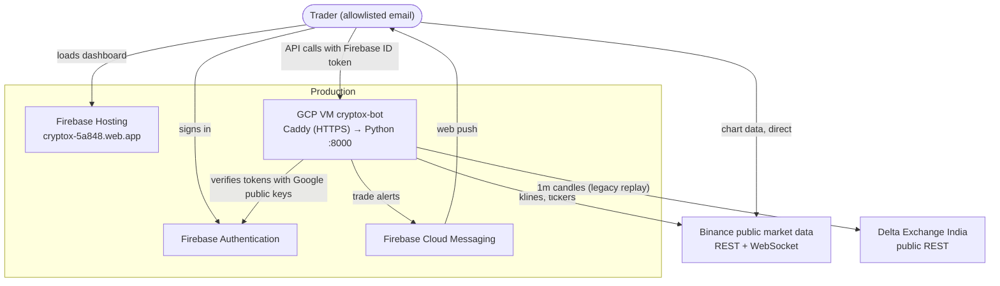
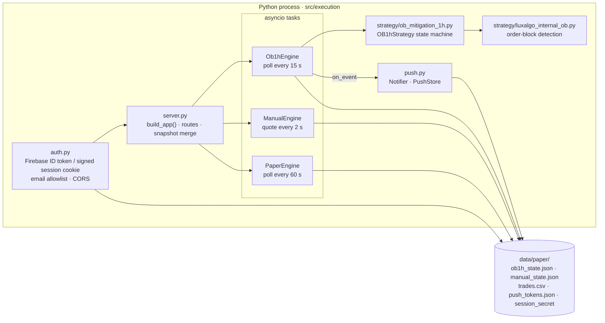
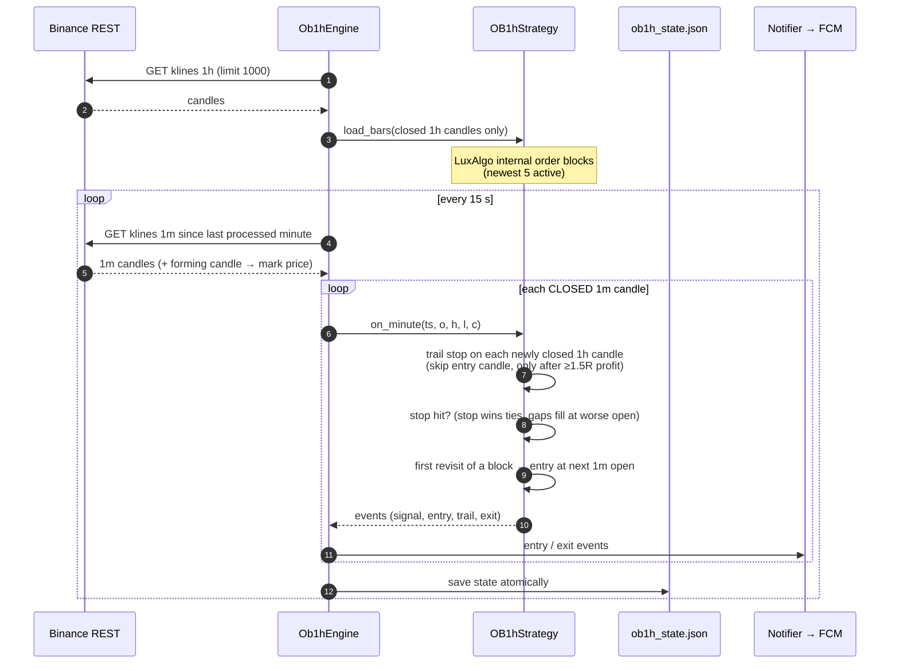
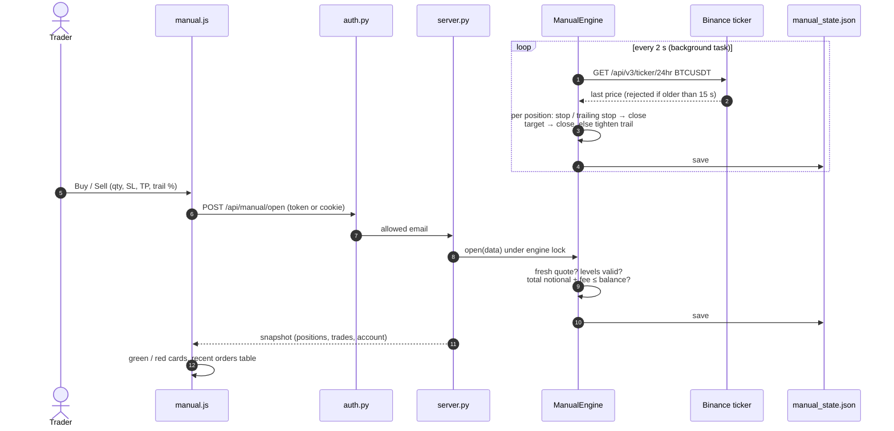
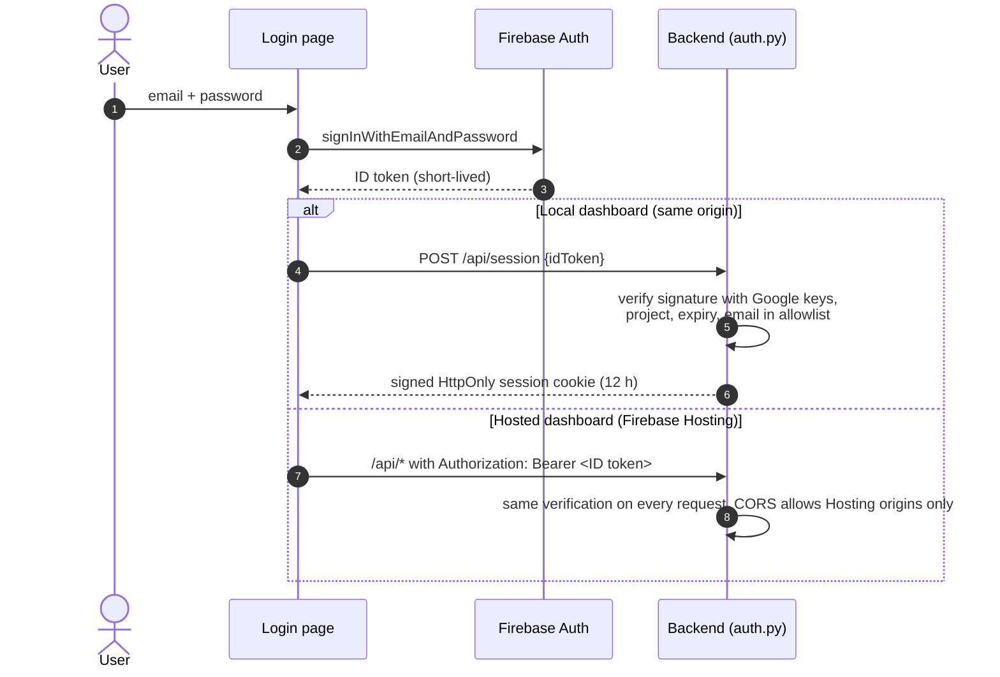
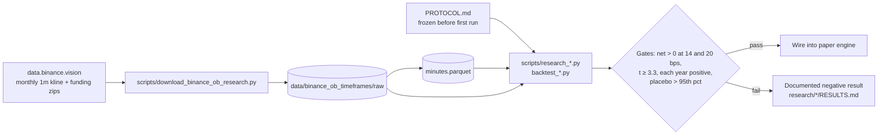
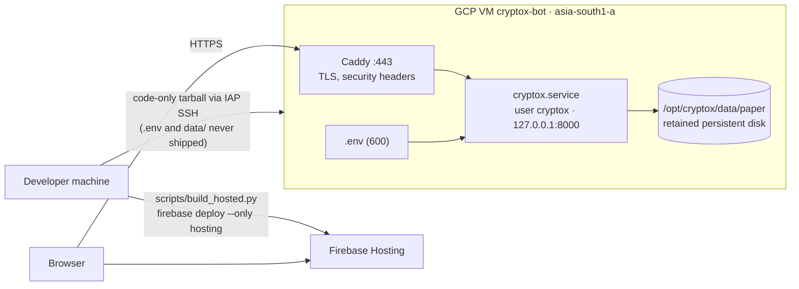

# Architecture

This document describes how CryptoX is put together and how data moves through it. Diagrams use Mermaid and render on GitHub.

## 1. System context

The browser fetches chart candles straight from Binance, so the chart works even when the backend is offline. Everything account-related goes through the backend.

## 2. Backend components

One Python process (`make paper`, or `cryptox.service` on the VM) runs an aiohttp web app and several long-lived asyncio tasks.

| Component | Responsibility | State file |
|---|---|---|
| `server.py` | Routes, static files, merges engine snapshots for `/api/strategies`, `/api/positions`, `/api/trades` | none |
| `auth.py` | Login page, `/api/session`, bearer token and cookie checks, allowlist re-checked on every request, CORS for Hosting origins | `session_secret` |
| `ob1h_engine.py` + `OB1hStrategy` | 1h order-block mitigation bot: detect blocks on closed 1h candles, enter on first revisit, manage stop and trail per 1m candle | `ob1h_state.json` |
| `manual_engine.py` | Multiple manual paper positions with SL, TP and trail, checked on each quote | `manual_state.json` |
| `paper_engine.py` | Legacy Delta OB-rejection replay (backs `/api/summary`) | `trades.csv` |
| `push.py` | Registers browser FCM tokens and sends entry and exit alerts (never stop-trail updates, never events older than 15 min) | `push_tokens.json` |
| `seasonality_engine.py` | Retired session-long strategy, used only by `scripts/backtest_seasonality.py` | none |

All state is written atomically (write to `.tmp`, then `os.replace`), so a crash never leaves a half-written file, and a restart resumes positions.

## 3. Data flow: 1H order-block paper bot

Rules that keep the bot honest:

- **Closed data only:** 1h candles are labelled by close time and used only after they close, and later minutes wait for the next 1h candle to be published.
- **Forward only:** on the first start, already-revisited blocks are marked used and no past trade is invented. After a gap of more than 3 days, blocks are re-baselined instead of replayed.
- **Costs:** 0.05% fee and 0.02% slippage per side. Risk is 0.5% of equity per trade, with a 3× notional cap.

## 4. Data flow: manual paper order

Each position has its own `id`. Update and close requests must name it, so a stale browser tab cannot change the wrong trade. Version 1 state files, which held a single position, are migrated on load.

## 5. Authentication flow

No service-account key file is used. Token verification uses Google's public certificates, and FCM sending uses the VM's attached service account through application default credentials.

## 6. Research pipeline

Backtests reuse the live state machines where one exists (`OB1hStrategy` is shared by `make ob1h-backtest` and the live bot), so paper results and backtests follow identical rules. Periods are split into development, validation and test or holdout. Parameters are chosen without looking at the final period.

## 7. Deployment topology

Updates back up `/opt/cryptox` to `/var/backups/cryptox/` before the code is swapped, then restart the service and check it. SSH is only through IAP, and only ports 80 and 443 are public.
